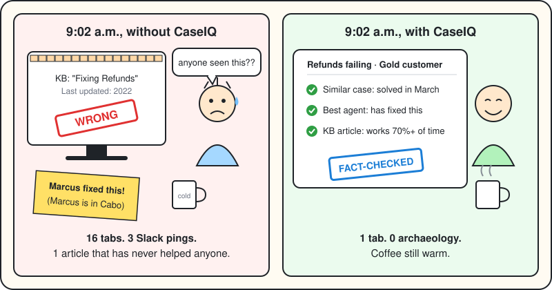
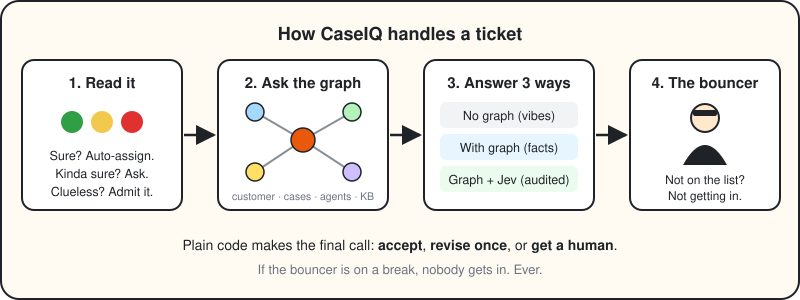
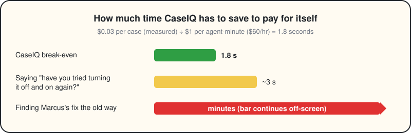
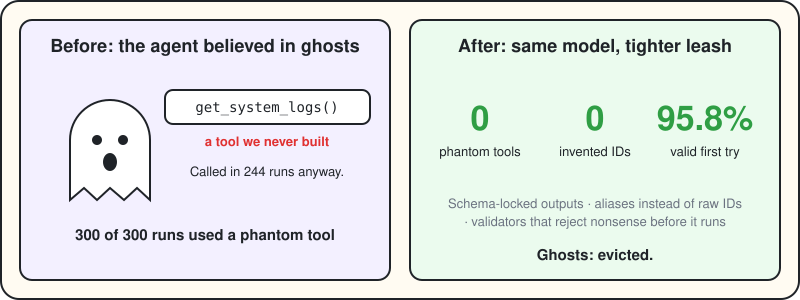

# CaseIQ

*Graph-powered support intelligence · Microsoft AI Graphs TPM Demo · June 2026*

> **9:02 a.m.** A Gold customer writes: *"Refunds are failing at checkout and finance is panicking."*
>
> The fix already exists. Marcus solved this exact problem in March. Marcus is also in Cabo.



---

## The problem: support archaeology

Priya, our support engineer, does not need to be smarter. The answer is already somewhere in her team's history. It's just spread across 10,000 old tickets, 150 colleagues, and 501 knowledge-base articles, some of which were last true in 2022.

So every new case starts with a dig: open tabs, ping Slack, find a "similar" case, realize it's a different product, start over. That's not support. That's support *logistics*, and it happens all day.

**CaseIQ gives that team a memory.**

---

## The fix: a graph that remembers, and a bouncer that checks



**It reads the ticket.** If it's 80%+ sure of the product, it just assigns it. Between 60 and 79%, it asks Priya for one click. Below that it tries semantic search, and if that fails too, it admits it doesn't know and hands her a picker. It would rather say "you pick" than be confidently wrong.

**It asks the graph.** One Neo4j traversal pulls the customer's history, similar solved cases (fastest fixes first), the colleague who has actually fixed this before, and only the KB articles that work at least 70% of the time. The 2022 article is not invited.

**It answers three ways, side by side.** *No graph* (the model guessing from the internet, i.e. vibes), *with graph* (grounded in the team's own history), and *graph + Jev* (grounded and audited). The difference is the whole pitch.

**Then the bouncer checks it.** Jev, a second model, plus four plain-code checks. Are the named people and articles real? Do the quoted numbers match? Was the evidence used? Then plain code, not a model, decides: accept, revise once, or get a human. If the bouncer is on a break, nobody gets in. No exceptions.

---

## The math: you need to beat a sneeze



The full pipeline costs about **$0.03 per case** (measured). An agent's time costs about **$1 a minute** (assumed $60/hour). So CaseIQ pays for itself if it saves **1.8 seconds per case**.

*Pretend* a team runs 10,000 cases a month and saves 2 minutes on each. That's about **$20,000 of time back for about $300 of model spend.** Bring your own numbers, and don't forget hosting and review time.

Bonus: auditing agent work with Jev cost **$0.18 per 1,000 judgments vs. $3.52** with an LLM judge. About 20x cheaper, and good at spotting missed evidence (AUC 0.84) and anchoring (AUC 0.85).

---

## The plot twist: our agent believed in ghosts



The first diagnostic agent was... creative. In 300 baseline runs it called a tool that doesn't exist **every single time**. Its favorite was `get_system_logs()`, which we never built and which it remained certain about anyway.

Same model, tighter leash (locked output schemas, aliases instead of raw IDs, validators that reject nonsense before it runs): **0 phantom tools, 0 invented IDs, 95.8% valid answers on the first try.**

And since you'll find this anyway, here's what's still not great *(synthetic data, dev cases only)*:

- **Root cause is hard.** 6% accuracy (1 of 17) for every architecture. The plumbing is solid. The detective needs work.
- **The cheap model won a round.** LLM-only scored 71% on issue category vs. 41% with the graph, on a set that deliberately includes the graph agent's worst runs. Humbling.
- **The agent is a people-pleaser.** An early Jev hint lifted its first answers from 14 to 21 correct out of 35, but it also adopted all 8 *wrong* hints without a fight.
- **The bouncer is nervous.** It sends 88% of cases to a human. Careful, not clairvoyant.

**Next up:** a better detective, an agent that argues with hints, a calmer bouncer, then real tickets.

---

## Try it

```bash
pip install -r requirements.txt     # pulls PyTorch, ~2 min. Make coffee.
cp .env.example .env                # add your keys
python3 data/generate_data.py       # fake customers, real chaos (one-time)
python3 agent/neo4j_loader.py       # load the demo graph (one-time)
./start.sh                          # add --dashboard for the KPI dashboard on :8502
```

No typing required: three one-click demos (refund failure, SSO blocker, analytics export bug). Open **Diagnostic Agent** in the sidebar to watch all three architectures fight over the same case.

**Keys:** the live app needs `GROQ_API_KEY`, `LANGCHAIN_*` and `NEO4J_*`. The research side adds `NEO4J_V2_*`, `TOGETHER_API_KEY` and `TYPESAFE_API_KEY`. See `.env.example`.

**Things that will bite you:**

- Neo4j Aura Free naps after ~3 idle days. `python3 -m agent.neo4j_health` tells you who's asleep.
- Don't touch the pins (`langchain==0.2.16`, `langchain-core==0.2.43`, `streamlit==1.35.0`, `tenacity==8.5.0`). Never install `typesafe-sdk` or `langchain-openai`. Run `pip check` after installs.
- Groq's free tier is 8,000 tokens/min, so the CLI demo takes a 62-second breather between scenarios.

**Tests:** `python3 run_evals.py` runs the 20-case eval suite and logs to LangSmith. Unit tests live in `agent/*/test_*.py` and never call a paid API.

---

## Under the hood

**Stack:** Neo4j AuraDB · Streamlit · LangChain · LangSmith · `sentence-transformers` · `gpt-oss-120b` on Groq (live app) · Llama 3.3 70B on Together AI (diagnostic agent) · Jev (`jev-1.13.0`) · Python 3.11+.

**The research behind it:** nine phases, from a synthetic support universe (25,000 cases with hidden answers) to a 116,868-node graph, a diagnostic agent, a strict grader with a test set nobody has peeked at, and the runtime verifier. The agent can only read the graph, never the answers. Details in [`docs/`](docs/) and [`data/README.md`](data/README.md).

---

*Priya and Marcus are fictional. The measured numbers are real. CaseIQ is a demo, not a production system, and the ROI math is a template, not a promise.*
